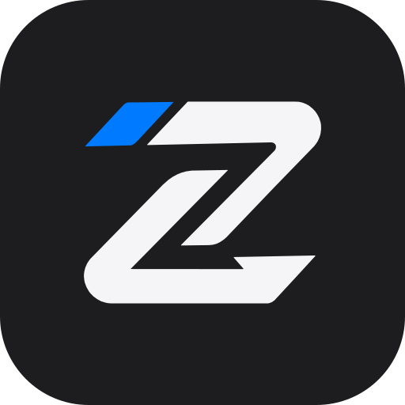

<p align="center"></p>

# Zenvy

Control your Hyprland PC from your phone: touchpad, keyboard, windows and workspaces, media and volume, brightness, a live screen preview you can click through, files, clipboard, the PC's sound on your phone, power and unlock. Nothing leaves your network: no account, no cloud, no telemetry.

**Status:** feature-complete for daily use on Hyprland and heading for its first public release (0.1.0). It is tested on one reference machine (Arch Linux, Hyprland); other distributions are untested for now. [PLAN.md](PLAN.md) is the full design and records what was verified and what is still assumed. Security model and reporting: [SECURITY.md](SECURITY.md).

For development (see [CONTRIBUTING.md](CONTRIBUTING.md)):

```bash
cargo build
target/debug/zenvyd doctor        # probe capabilities
target/debug/zenvyd state         # monitors / workspaces / windows
target/debug/zenvyd watch         # live (coalesced) Hyprland events
target/debug/zenvyd serve         # HTTPS+WebSocket server (binds the default-route LAN address)
target/debug/zenvyd pair          # QR code + approve the phone on this PC
target/debug/zenvyd devices | revoke <id>
cargo test
```

**Android app:** see [android/README.md](android/README.md) (installed with `adb install`).

`spikes/` holds throwaway Phase 0 experiments (separate workspace); they are not part of the product.

## Install and run

You need Hyprland on Wayland, a phone on the same network, and (optional, each enables a feature) `grim`, `wl-clipboard`, `pipewire-pulse`/`libpulse`, `libnotify`, `ddcutil` and `wtype`; `zenvyd doctor` shows what is missing.

**Arch Linux:** `makepkg -si` in `packaging/arch/` (it builds from the release tarball; an AUR package will follow), then `systemctl --user enable --now zenvyd`.

**Any distribution, as your user (nothing outside your home directory):**

```bash
git clone https://github.com/Andrew-Velox/Zenvy && cd Zenvy
packaging/install.sh --enable      # builds with cargo (or uses the prebuilt zenvyd from a release tarball),
                                   # installs ~/.local/bin/zenvyd and a systemd user service, starts it
zenvyd pair                        # QR code; scan it with the Android app, then approve on this PC
```

The service starts at login (`journalctl --user -u zenvyd` for logs) and only authenticated, approved phones can use it. `packaging/uninstall.sh` removes it again (`--purge` also deletes paired phones and settings; your received files are never touched). Stopping or restarting the service does not close apps you started from the phone.

The prebuilt `zenvyd` in a release is built on Ubuntu 24.04 (glibc 2.39 or newer, plus `libopus`); on an older system `packaging/install.sh` builds from source instead.

The Android app is in the release as an APK (`adb install`, or open the file on the phone); to build it yourself see [android/README.md](android/README.md). Releases are checksummed, built reproducibly and carry signed provenance ([docs/RELEASING.md](docs/RELEASING.md), [docs/REPRODUCIBLE.md](docs/REPRODUCIBLE.md)).

## Browser tabs (optional)

Run `zenvyd browser setup` and follow the steps to load `browser-extension/` in Brave or Chrome. The phone's Desk screen then shows a **tabs** chip on browser windows, where you can switch, close or open tabs. Only tab titles and site names are shared, with this PC only (loopback, token protected). Details: [browser-extension/README.md](browser-extension/README.md) and PLAN.md Appendix H.

## What the phone can do

| Screen | What it does | Permission |
| --- | --- | --- |
| Desk | workspaces, windows (focus, close, move, float), browser tabs, custom actions, **open an installed app here or on a new empty workspace** (the `+` chip), **move a window to another workspace** (the arrow on each window) | `view`, `windows`, `exec`, `launch` |
| Touchpad | pointer, scroll, clicks, drag, typing | `input` |
| Keyboard | keys, shortcuts, live typing, clipboard to and from the PC, send and receive files, links | `input`, `clipboard`, `files` |
| Media | player controls, volume, **phone speaker** (the PC's sound played on the phone) | `system`, `listen` |
| Screen | **monitor brightness**; live preview of a monitor (a floating, draggable window on the other tabs); tap to click, double-tap to double-click, hold to right-click | `system` (brightness), `screen` (+ `input` to click) |
| Power / lock | lock, sleep, restart, power off (confirm + countdown), type the password on the lock screen | `power`, `unlock` |

A newly paired phone only gets `view`, `input`, `windows` and `system`. Everything that reads, plays or sends something from your PC is a separate permission you give on the PC:

```bash
zenvyd devices                     # ids of the paired phones
zenvyd grant <id> screen           # also: listen clipboard files exec launch power unlock
zenvyd revoke <id>                 # remove a phone entirely
zenvyd send ~/report.pdf           # offer a file to the connected phones
```

When the PC is locked the phone gets a lock page (media, volume, brightness, power and unlock only): no windows, input, tabs, clipboard, files or screen. Starting and stopping the screen preview or the phone speaker is logged and shown as a desktop notification.

## Configuration (optional)

`~/.config/zenvy/config.toml`, every key has a default:

```toml
[files]
inbox = "~/Downloads/Zenvy"      # where files from the phone land (never overwritten)
max_size_mb = 2048

[lock]
unlock_from_phone = true         # allow typing the password from a phone that has `unlock`

[[actions]]                      # buttons on the Desk screen; a fixed argument list, never a shell line
id = "hello"
label = "Say hello"
argv = ["notify-send", "Hello from the phone"]
confirm = false                  # true = ask on the phone first
```

## Privacy and security in short

* Nothing leaves your network. No telemetry, no accounts, no cloud. The phone trusts exactly one certificate (pinned from the pairing QR); the agent trusts exactly the phones you approved.
* The agent runs as you, never as root. Passwords are typed through a virtual keyboard only while the PC is locked and are never logged or echoed.
* Machine and monitor serial numbers are never stored or sent. Screen frames and files are never kept by the agent, only the file you chose to receive.
* The app that shows the PC's screen needs `grim`; the phone speaker needs `parec`; clipboard needs `wl-clipboard`; notifications use `notify-send` when present. Anything missing simply turns that feature off (`zenvyd doctor` shows which).

## Tests

```bash
cargo test                       # unit tests
tests/run-e2e.sh                 # sandboxed end-to-end suite against a throwaway agent (needs a running Hyprland session)
node tests/typing.mjs && node tests/worklet.mjs
```

The end-to-end suite drives only scratch windows named `zenvy-*`, keeps the pointer inside them, uses fake `systemctl`, `loginctl`, `wl-copy`, `grim` and friends (it never suspends the PC or captures the real screen), and refuses to run if a real `zenvyd` or a leftover scratch window exists.
