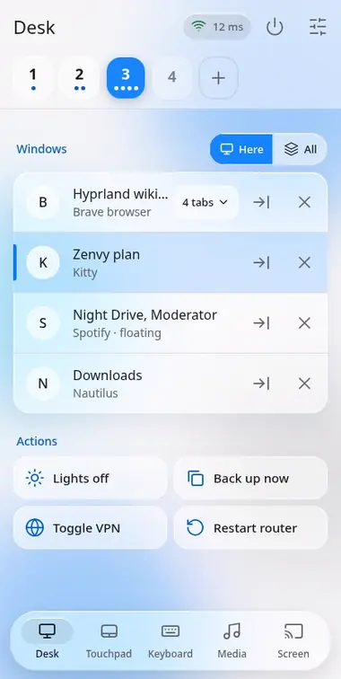
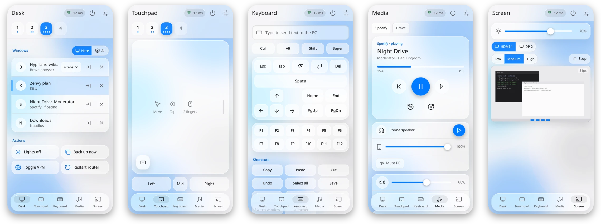
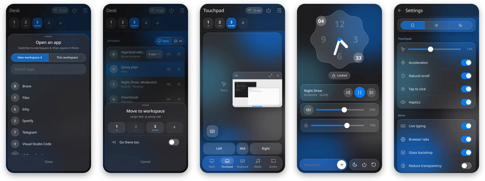
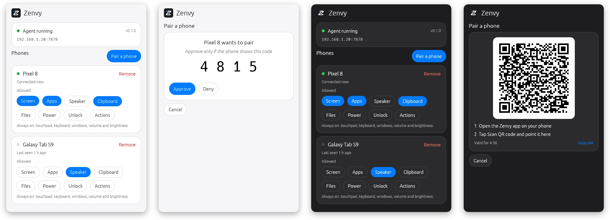

<p align="center"></p>

# Zenvy

Control your Hyprland PC from your phone. Touchpad, keyboard, windows and workspaces, media, volume, brightness, a live screen you can tap through, files, clipboard, power and unlock. No cloud, no account, no telemetry: the phone talks straight to the PC over your own network.

<p align="center"></p>

<p align="center"><sub>Recorded on a real phone and a real Hyprland desktop at the same time. The blue rings are where a finger touched the phone. The video is <i>Big Buck Bunny</i>, © Blender Foundation | www.bigbuckbunny.org, <a href="https://creativecommons.org/licenses/by/3.0/">CC BY 3.0</a>.</sub></p>



## Features

- **Desk**: workspaces, windows (focus, close, move to another workspace), browser tabs (extension), and your own one-tap actions.
- **Open apps anywhere**: the `+` next to the workspaces lists your installed apps; one tap switches to the first empty workspace and starts the app there.
- **Touchpad and keyboard**: pointer, scroll, clicks, drag; live typing with any layout and Unicode, shortcuts and special keys.
- **Screen**: a live preview of any monitor you can tap, long-press and double-tap to click. It floats as a draggable, resizable window over every other tab. Monitor brightness lives here too.
- **Media**: player controls, the **player's own volume** and the PC volume as two separate sliders, and the **phone speaker**: the PC's sound played on your phone.
- **Files and clipboard**: send files both ways, copy text to the PC clipboard, share a link from any phone app to open it on the PC.
- **Power and lock**: lock, sleep, restart, power off (with confirmation and a countdown). When the PC is locked, the phone mirrors the lock screen and can type the password.
- **Private by design**: each feature beyond the basics is a permission you grant per phone, and a locked PC refuses everything but media, volume, brightness, power and unlock.



## Install

Zenvy has two parts: the **agent** (`zenvyd`) on the PC and the **Android app**. You need Hyprland on Wayland and a phone on the same network.

### 1. The agent

**From a release:**

```bash
tar xzf zenvy-0.1.0-x86_64-linux.tar.gz && cd zenvy-0.1.0-x86_64-linux
packaging/install.sh --enable       # installs ~/.local/bin/zenvyd and a systemd user service, starts it
```

**From source** (needs Rust, `libopus` and a C compiler):

```bash
git clone https://github.com/Andrew-Velox/Zenvy && cd Zenvy
packaging/install.sh --enable       # builds with cargo, then installs the same way
```

**Arch Linux:** `makepkg -si` in `packaging/arch/`, then `systemctl --user enable --now zenvyd`.

The prebuilt binary is built on Ubuntu 24.04 and needs glibc 2.39 or newer; on an older system build from source. The script installs for your user only and touches nothing outside your home directory. Logs: `journalctl --user -u zenvyd`.

### 2. Firewall

The agent listens on one LAN address, port 7878 (TCP). If you run a firewall, allow your local network to reach it:

```bash
sudo ufw allow from 192.168.1.0/24 to any port 7878 proto tcp          # ufw
sudo firewall-cmd --permanent --add-rich-rule='rule family="ipv4" source address="192.168.1.0/24" port port="7878" protocol="tcp" accept' && sudo firewall-cmd --reload   # firewalld
```

(Use your own network range.) Do not forward this port to the internet.

### 3. Pair your phone

The easiest way is the **Zenvy window** that the installer adds to your launcher (or run `zenvy`):



It shows whether the agent is running, lists your phones with a switch for each permission, and pairs a new phone. Everything it does is available from the terminal too, and the steps below use the terminal.

1. Install the Android app (the APK from the release, or build it: [android/README.md](android/README.md)).
2. On the PC run `zenvyd pair`. It shows a QR code.
3. In the app tap **Scan QR code**. The phone shows a 4-digit code; the PC asks you to approve the phone only if the same code is shown there.

The phone now holds its own key and trusts exactly this PC's certificate. List or remove phones any time with `zenvyd devices` and `zenvyd revoke <id>`.

### 4. Allow the extras

A new phone gets only the basics: view, touchpad and keyboard, windows, volume and brightness. Everything else you switch on yourself, per phone, in the Zenvy window (the buttons under each phone; the sensitive ones ask first) or in the terminal:

```bash
zenvyd grant <id> screen            # screen preview (and clicking through it)
zenvyd grant <id> launch            # open apps from the phone
zenvyd grant <id> listen            # phone speaker
zenvyd grant <id> clipboard         # clipboard and links      (also: files = file transfer)
zenvyd grant <id> power             # power menu               (also: unlock = type the password on the lock screen)
zenvyd grant <id> exec              # your own actions from config.toml
zenvyd ungrant <id> screen          # take one away
```

If a phone tries something it may not do yet, the app shows the exact command to run.

## Requirements

Everything optional simply turns its feature off when a tool is missing. `zenvyd doctor` shows what works on your machine.

| Feature | Needs |
| --- | --- |
| Touchpad, clicks, typing | write access to `/dev/uinput` (see below); `wtype` for text |
| Windows, workspaces, apps | Hyprland |
| Screen preview | `grim` |
| Clipboard, links | `wl-clipboard` (`wl-copy`, `wl-paste`) |
| Volume, phone speaker | PipeWire or PulseAudio with `pactl` and `parec` (`libpulse`) |
| Media controls | any MPRIS player and a D-Bus session bus |
| Brightness | `ddcutil` with DDC/CI enabled on the monitor, or a laptop backlight |
| Desktop notices | `notify-send` (`libnotify`) |
| Power and lock | `systemd` (`systemctl`, `loginctl`) |
| The Zenvy window | a Wayland or X11 session with OpenGL (Mesa); `libxkbcommon` |

### Letting the agent type and click

Pointer and key input go through a virtual device, which needs write access to `/dev/uinput`. This is a change to your system, so Zenvy never does it for you. If `zenvyd doctor` says input injection is unavailable:

```bash
sudo modprobe uinput
echo 'KERNEL=="uinput", GROUP="input", MODE="0660", OPTIONS+="static_node=uinput"' | sudo tee /etc/udev/rules.d/60-zenvy-uinput.rules
sudo usermod -aG input "$USER"        # then log out and back in
```

Anything running as a member of the `input` group can then inject input, which is true on every system that allows this. Zenvy only uses it for phones you paired.

## Configuration

Optional. `~/.config/zenvy/config.toml`, every key has a default; `zenvyd config` checks the file.

```toml
[server]
bind = ["192.168.1.20"]            # default: the address of your default route
port = 7878

[files]
inbox = "~/Downloads/Zenvy"        # where files from the phone land (never overwritten)
max_size_mb = 2048

[[actions]]                        # buttons on the Desk screen, need the `exec` permission
id = "hello"
label = "Say hello"
icon = "zap"
argv = ["notify-send", "Hello from the phone"]   # a fixed argument list, never a shell line
confirm = false                    # true = ask on the phone first
```

## Browser tabs (optional)

Run `zenvyd browser setup` and follow the steps to load [`browser-extension/`](browser-extension/README.md) in Brave or Chrome. The Desk screen then shows a **tabs** chip on browser windows to switch, close or open tabs. Only tab titles and site names are shared, with this PC only (loopback, token protected).

## Privacy and security

- Nothing leaves your network. No telemetry, accounts or cloud. Machine and monitor serial numbers are never stored or sent.
- A phone is trusted because it holds a key you approved, not because it is on your Wi-Fi. The app only talks to the certificate it paired with.
- The agent runs as you, never as root. Screen frames, clipboard text and files are never kept; passwords are typed only while the PC is locked and never logged.
- Starting the screen preview or the phone speaker, launching apps, power actions and permission changes are audit-logged and shown as a desktop notice.

Details, limits and how to report a problem: [SECURITY.md](SECURITY.md).

## How it works

| Crate | Role |
| --- | --- |
| `zenvyd` | the agent and its command line |
| `zenvy-gui` (`zenvy`) | the desktop window: pairing and permissions, a front end to the agent's local admin socket |
| `zenvy-net` | HTTPS and WebSocket server, pairing, permissions, the phone UI (`page.html`) |
| `zenvy-hyprland` | Hyprland IPC: state and typed commands |
| `zenvy-input`, `zenvy-audio`, `zenvy-media`, `zenvy-brightness`, `zenvy-power`, `zenvy-screen`, `zenvy-stream`, `zenvy-apps`, `zenvy-icons` | one backend each, with fakes for tests |
| `zenvy-auth`, `zenvy-proto`, `zenvy-config`, `zenvy-core`, `zenvy-profiler` | keys and pairing, message types, configuration, capability model, local device profile |
| `android/`, `browser-extension/` | the certificate-pinned Android shell, the optional tab bridge |

The phone UI is one embedded web page served by the agent, shown in a thin native Android shell. [PLAN.md](PLAN.md) holds the full design and records what was verified and what is still assumed.

## Development

```bash
cargo build && cargo test --workspace
cargo fmt --all && cargo clippy --workspace --all-targets
tests/run-e2e.sh                  # sandboxed end-to-end suite; needs a running Hyprland session
node tests/typing.mjs && node tests/worklet.mjs
(cd android && ./gradlew testDebugUnitTest assembleDebug)
```

The end-to-end suite only touches scratch windows named `zenvy-*`, uses fake `systemctl`, `loginctl`, `grim`, `wl-copy` and friends (it never suspends your PC or captures your screen), and refuses to run if a real `zenvyd` is running. See [CONTRIBUTING.md](CONTRIBUTING.md). The screenshots come from the UI's built-in demo mode (`tools/screenshots.mjs`). The demo animation is recorded for real by `tools/real-demo/` (it drives a phone over adb and records the desktop with `wf-recorder`); `tools/demo.mjs` makes a simulated version that needs no hardware. Releases: [docs/RELEASING.md](docs/RELEASING.md), [docs/REPRODUCIBLE.md](docs/REPRODUCIBLE.md).

## Uninstall

```bash
packaging/uninstall.sh            # removes the program and the service
packaging/uninstall.sh --purge    # also deletes paired phones, the certificate, settings and the audit log
```

Files you received (`~/Downloads/Zenvy`), the Android app and the browser extension are yours to remove.

## Status

Feature-complete for daily use on Hyprland and heading for its first public release (0.1.0). It is tested on one machine (Arch Linux, Hyprland), so other distributions and compositors are untested for now. `spikes/` holds throwaway early experiments and is not part of the product.

## License

[MIT](LICENSE)
